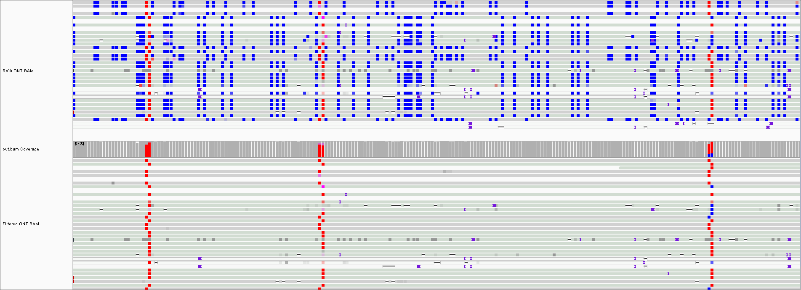

# ont-cpg-filter

[](LICENSE)

Rewrites the base modification calls in an aligned Oxford Nanopore BAM so that
only calls on CpG sites of the reference remain.

Modification calls are stored in the `MM` (positions) and `ML` (probabilities)
SAM tags. This tool changes only those two tags. Alignments, flags and
sequences are not changed.



## Behaviour

For each read with `MM`/`ML` tags:

- **CpG positions** (defined by the reference FASTA and the motif, default `CG`)
  keep their call. If the input had no call at a CpG C (or G on the reverse
  strand), a call with ML = 0 (unmodified) is added.
- **All other positions** are removed from `MM`/`ML`. The MM flag is set to `?`,
  so these positions have no information and are not shown as modified or
  unmodified.
- Calls on soft-clipped or inserted bases are removed.

Orientation: `MM` refers to the original read. For reverse-aligned reads the
stored SEQ is the reverse complement, so the strand is flipped and the skip
counts run from the end of SEQ.

The CpG decision is made only from the reference, never from SEQ.

## Requirements

- Python 3.10 or newer
- pysam, numpy, tqdm (installed by pip)
- A reference FASTA of the same genome build as the BAM. A `.fai` index is
  created automatically if it is missing.
- An aligned BAM with `MM`/`ML` tags. Only the `MM`/`ML` tag pair is handled.
  The older `Mm`/`Ml` tags are not. Numeric ChEBI modification codes are not
  supported.

## Installation

```bash
python -m venv .venv
source .venv/bin/activate
pip install -e ".[dev]"
```

## Commands

The tool has two commands: `filter` and `index`.

### filter

```bash
ont-cpg-filter filter input.bam output.bam -r genome.fa
```

| Option | Short | Default | Meaning |
|---|---|---|---|
| `--reference` | `-r` | required | Reference FASTA |
| `--motif` | `-m` | `CG` | Two-base motif that must contain the modified base |
| `--threads` | `-t` | `1` | htslib threads for BAM compression and decompression |
| `--progress` | `-p` | off | Show a progress bar. Costs some speed |
| `--no-output-index` | | off | Do not write `output.bam.bai` |
| `--no-reference-index` | | off | Do not use the CpG index; compute the bitmaps during the run |
| `--verbose` | `-v` | | Debug logging with `-vv` |

The output BAM is indexed automatically unless `--no-output-index` is given.

### index

```bash
ont-cpg-filter index genome.fa --motif CG
```

Builds the CpG index `genome.fa.CG_idx` next to the FASTA. The index is used by
`filter` automatically when it exists and matches the FASTA and the motif.

If there is no index, `filter` computes the bitmaps per chromosome during the
run and logs that. If the index exists but does not match the FASTA (size or
mtime) or the motif, `filter` stops with an error and shows the command to
rebuild it.

The index needs about 800 MB of memory while it is built, for a human genome.

## Benchmark

`bench/run_bench.py` times three variants on the same BAM:

- `baseline`: reads the BAM and fetches the tags, without filtering
- `indexed`: uses `<fasta>.<MOTIF>_idx`
- `on-the-fly`: computes the bitmaps during the run

It also checks that `indexed` and `on-the-fly` give identical output.

```bash
python bench/run_bench.py input.bam -r genome.fa
python bench/run_bench.py input.bam -r genome.fa --variants indexed on-the-fly
```

The benchmark builds the index before the timed runs if it is missing. Timing
covers reading, filtering and tag handling, not writing the output BAM.

## Tests

```bash
pytest
```

## License

This project is licensed under the MIT License. See [LICENSE](LICENSE).

## Limitations

- Only `MM`/`ML` tags are handled, not `Mm`/`Ml`.
- Numeric ChEBI modification codes raise an error.
- Reads without an `MM` tag are written unchanged.
- The BAM is processed in one process. `--threads` only speeds up compression.
